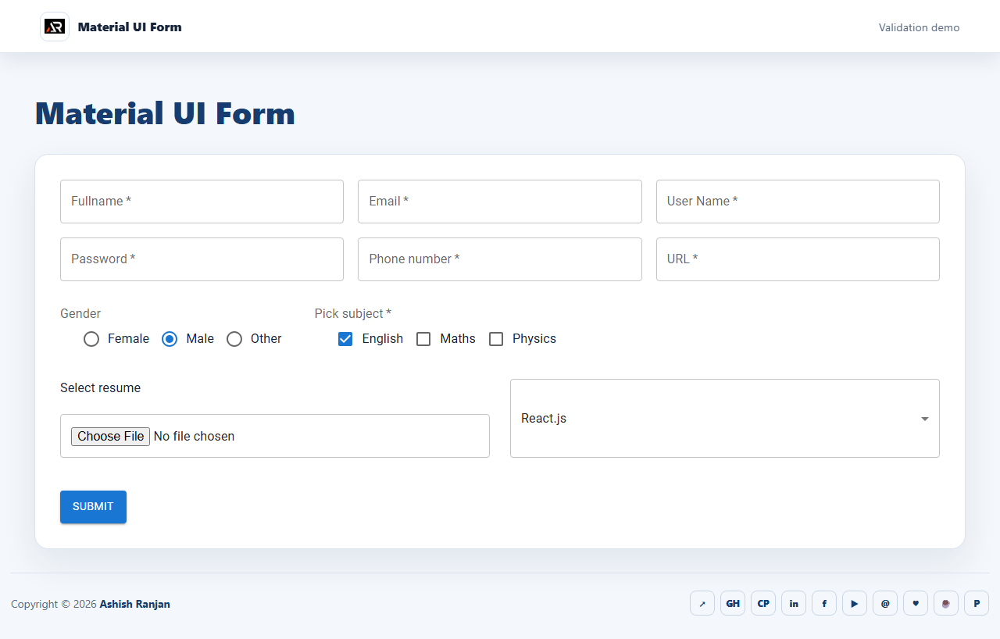

# Material UI Form

A responsive React form demo built with Material UI. It includes field validation, radio controls, checkboxes, file selection, grouped programming options and a submitted-data dialog.

## Run locally

```bash
npm install
npm run dev
```

## Preview



## Links and Support

- [Portfolio](https://www.ashishranjan.net/) · [GitHub](https://github.com/a2rp) · [CodePen](https://codepen.io/ash1198) · [LinkedIn](https://www.linkedin.com/in/aashishranjan)
- [Facebook](https://www.facebook.com/theash.ashish/) · [YouTube](https://www.youtube.com/@ashishranjan-ashz?sub_confirmation=1) · [Email](mailto:ash.ranjan09@gmail.com)
- [Support](https://a2rp-donation-page.netlify.app/) · [Buy Me a Coffee](https://buymeacoffee.com/a2rp) · [Patreon](https://www.patreon.com/a2rp)