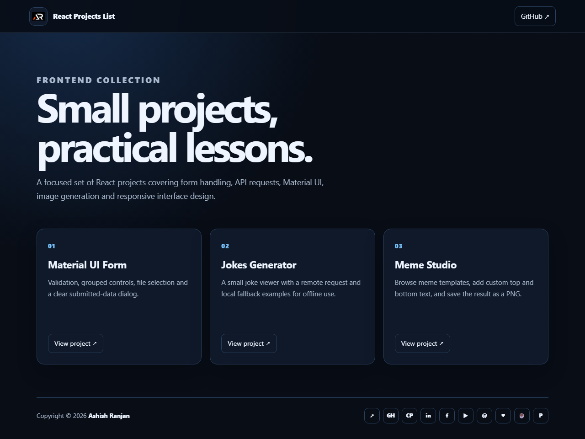

# React Projects List

A small collection of focused React frontend projects for practicing forms, API requests, Material UI, image generation and responsive interface design.

## Projects

### 1. Material UI Form

A responsive form demo with validation, radio controls, checkboxes, file selection, grouped options and a submitted-data dialog.

Run it:

```bash
cd 1-mui-form
npm install
npm run dev
```

### 2. Jokes Generator

A lightweight joke viewer that loads a random joke from a public endpoint and falls back to local examples when the request is unavailable.

Run it:

```bash
cd 2-jokes-generator
npm install
npm run dev
```

### 3. Meme Studio

A meme template browser that loads templates from Imgflip, overlays custom text and lets users save a generated image.

Run it:

```bash
cd memes-generator/frontend
npm install
npm run dev
```

## Tech Stack

React, JavaScript, Vite, Material UI, Sass and CSS. The Vite apps require Node.js 20.19+ or 22.12+.

## Preview



## Links

- [Portfolio](https://www.ashishranjan.net/)
- [GitHub](https://github.com/a2rp)
- [CodePen](https://codepen.io/ash1198)
- [LinkedIn](https://www.linkedin.com/in/aashishranjan)
- [Facebook](https://www.facebook.com/theash.ashish/)
- [YouTube](https://www.youtube.com/@ashishranjan-ashz?sub_confirmation=1)
- [Email](mailto:ash.ranjan09@gmail.com)

## Support

- [Support](https://a2rp-donation-page.netlify.app/)
- [Buy Me a Coffee](https://buymeacoffee.com/a2rp)
- [Patreon](https://www.patreon.com/a2rp)
